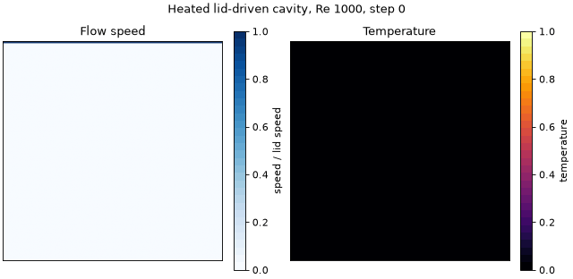

# Heated lid-driven cavity with the lattice Boltzmann method

A D2Q9 lattice-Boltzmann simulation of a square cavity. The top wall slides to the right and is held hot, the left and right walls are cold, and the bottom wall is insulated. The script runs the simulation and writes it as an animation of the flow speed and the temperature.



## Physics

Each node of the grid carries nine flow populations and nine temperature populations, one per lattice direction. The flow populations relax toward f_i^eq = w_i ρ (1 + 3 c_i·u + 4.5 (c_i·u)² − 1.5 |u|²), which recovers the incompressible Navier-Stokes equations at low Mach number, and the temperature populations relax toward g_i^eq = w_i T (1 + 3 c_i·u), which recovers the advection and diffusion of heat by that flow; the temperature does not act back on the flow. The walls use bounce-back for the flow, with a momentum correction on the moving lid, and anti-bounce-back for the fixed temperatures; the bottom wall copies the row above it, so no heat crosses it.

## Parameters

In lattice units, set in the `Parameters` dataclass at the top of `simulation.py`:

| Parameter | Value | Meaning |
| --- | --- | --- |
| `cavity_size` | 100 | side of the cavity; the grid has 101 x 101 nodes |
| `lid_velocity` | 0.2 | speed of the top wall |
| `viscosity` | 0.02 | kinematic viscosity |
| `prandtl_number` | 0.71 | viscosity over thermal diffusivity, the value for air |
| `lid_temperature` | 1.0 | temperature of the top wall |
| `side_wall_temperature` | 0.0 | temperature of the left and right walls |
| `initial_density` | 5.0 | density at the start; the fluid starts at rest and at temperature 0 |
| `steps` | 20000 | number of time steps |
| `snapshot_interval` | 200 | steps between two frames of the animation |

This gives a Reynolds number of 1000 (lid speed times cavity size over viscosity) and a Péclet number of 710. The relaxation rates follow from the viscosity ν and the thermal diffusivity α: 1/(3ν + 0.5) = 1.79 for the flow and 1/(3α + 0.5) = 1.71 for the temperature.

## Run

```bash
python3 -m venv .venv
source .venv/bin/activate
pip install numpy matplotlib
python simulation.py
```

The script prints the state every 2,000 steps and writes `cavity.gif` (101 frames, 3.1 MB). The run takes a little over two minutes on a laptop.

## What the run gives

- It stays stable for the 20,000 steps: no NaN, the density ends between 4.76 and 6.07 (it starts at 5), and the lid row moves at 0.200.
- The total mass drifts down by 0.79% over the run, at a steady rate, because the moving-lid boundary does not conserve mass exactly.
- The flow forms one main vortex. In the last frame the speed changes by at most 1.0e-4 over 200 steps, which is 0.05% of the lid speed.
- The heat is still spreading at the end: the mean temperature inside the cavity is 0.31 at step 10,000 and 0.38 at step 20,000.
- Away from the two top corners, where the hot lid meets the cold walls, the temperature stays between 0 and 1 to within 0.001. Within 14 nodes of those corners it reaches -0.011 and 1.225.
